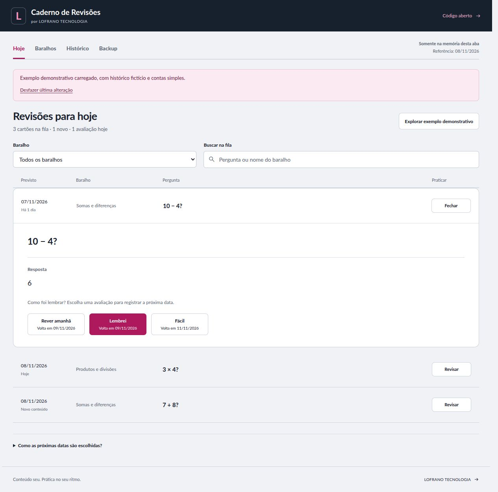

# Caderno de Revisões

Crie baralhos e cartões de texto, revele a resposta e registre sua própria avaliação. O aplicativo calcula a próxima data por uma regra pública e mantém versões do conteúdo e histórico de estudo.

[Abrir aplicativo](https://martinlofranodeoliveira.github.io/caderno-revisoes/) · [Código no GitHub](https://github.com/martinlofranodeoliveira/caderno-revisoes) · [LOFRANO TECNOLOGIA](https://lofranotecnologia.com.br)



[Ver a interface no celular](docs/images/fila-mobile.jpg)

## Começar

1. Em **Baralhos**, crie um baralho e adicione cartões com frente e verso.
2. Em **Hoje**, abra um cartão previsto e revele a resposta.
3. Escolha **Rever amanhã**, **Lembrei** ou **Fácil**. A avaliação é sua; o aplicativo não verifica a resposta nem usa IA.
4. Em **Backup**, baixe um JSON completo. Ative **Salvar caderno neste navegador** se quiser manter uma cópia local entre sessões.

O exemplo demonstrativo permite experimentar as telas com contas simples. Se houver baralhos, cartões, avaliações ou um nome de caderno personalizado, carregar o exemplo exige confirmação de substituição. A restauração de backup sempre mostra uma confirmação antes de trocar o caderno.

Para experimentar a importação, use [cartoes.csv](examples/cartoes.csv) em um baralho ou restaure [caderno-exemplo.json](examples/caderno-exemplo.json). São dados fictícios; as datas do JSON são fixas, de novembro de 2026, e não se renovam ao abrir o arquivo.

A prática abre na própria linha da fila. As avaliações aparecem depois de **Mostrar resposta**. Após registrar uma avaliação, o próximo cartão disponível nos filtros atuais abre com a resposta oculta e aguarda sua ação. Se o dia mudar entre abrir e avaliar, a fila é atualizada e você precisa abrir o cartão novamente.

## Como a agenda funciona

A data de referência usa o fuso `America/Sao_Paulo`. A fila contém as versões atuais dos cartões não arquivados cuja data prevista é igual ou anterior à data de referência. Abrir ou revelar um cartão não altera a agenda.

Fila, cartões e histórico exibem até 50 registros por página. A paginação não limita quantos cartões previstos você pode praticar no dia, dentro dos limites do caderno.

Cada versão começa no estágio 0, prevista para a data de criação daquela versão. A avaliação escolhe o estágio de destino:

| Avaliação na tela | Valor no backup | Próximo estágio |
| --- | --- | --- |
| Rever amanhã | `again` | 0 |
| Lembrei | `good` | estágio atual + 1, até 6 |
| Fácil | `easy` | estágio atual + 2, até 6 |

| Estágio de destino | 0 | 1 | 2 | 3 | 4 | 5 | 6 |
| --- | --- | --- | --- | --- | --- | --- | --- |
| Intervalo em dias | 1 | 1 | 3 | 7 | 14 | 30 | 60 |

O intervalo parte da data em que você avaliou, inclusive quando a revisão estava atrasada. Uma versão pode receber uma avaliação por dia, somente a partir da data prevista. Por exemplo, **Fácil** no estágio 0 leva ao estágio 2 e agenda três dias depois.

Essa é uma regra de organização do aplicativo, sem promessa de eficácia pedagógica. Não há notificações em segundo plano.

## Conteúdo e histórico

- Alterar a frente ou o verso cria uma versão e reinicia a agenda desse conteúdo. As versões e avaliações anteriores continuam no histórico. Salvar textos idênticos não cria versão.
- Mover um cartão de baralho preserva versões e progresso.
- Arquivar retira o cartão da fila e preserva o histórico; desarquivar o devolve à agenda existente.
- Excluir um cartão remove também suas versões e avaliações, após confirmação. A interface oferece desfazer somente a última alteração durante a sessão.
- Um baralho só pode ser removido quando não tiver cartões, incluindo arquivados.

No histórico, a frente é a da versão avaliada. O baralho e seu nome são os atuais, mesmo se o cartão tiver sido movido ou o baralho renomeado depois.

Em **Baralhos**, **Ver versões do conteúdo** mostra frente e verso de cada versão. No histórico, **Conferir resposta daquela versão** permite consultar o verso efetivamente avaliado.

## Backup e CSV

O **JSON** é a cópia editável completa: preserva textos, baralhos, arquivamento, versões e avaliações. Restaurá-lo substitui o caderno, após validação e confirmação; não mescla documentos.

O **CSV de cartões** contém apenas a frente e o verso atuais dos cartões não arquivados do baralho selecionado. Para importar, escolha explicitamente `;` ou `,` e use o cabeçalho `Frente;Verso` ou `Frente,Verso`. O aplicativo mostra uma prévia e valida todas as linhas antes de adicionar os cartões. Eles entram como cartões novos, sem histórico.

A exportação de CSV pela interface usa ponto e vírgula. Arquivos JSON e CSV são lidos como UTF-8; bytes inválidos são recusados, preservando o caderno atual.

O **CSV de histórico** é um relatório das avaliações, com a frente da versão avaliada e sem o verso. Ele não é um arquivo de restauração.

Os CSVs exportados incluem BOM UTF-8 e usam CRLF entre registros. Para reduzir a interpretação de fórmulas por planilhas, valores potencialmente executáveis recebem um apóstrofo inicial. Esse apóstrofo permanece se você importar o CSV novamente. Use JSON para preservar exatamente o texto editável.

| Limite | Valor |
| --- | --- |
| Baralhos por caderno | 100 |
| Cartões por caderno, incluindo arquivados | 2.000 |
| Versões por cartão | 20 |
| Avaliações por caderno | 50.000 |
| Backup JSON e JSON canônico completo | 8 MiB (8.388.608 bytes UTF-8) |
| CSV de entrada | 1 MiB (1.048.576 bytes UTF-8), até 500 cartões |
| Frente e verso | 4.000 pontos Unicode por lado |

O backup usa JSON indentado quando cabe no limite; perto de 8 MiB, usa JSON compacto para continuar restaurável. A exportação CSV pode ultrapassar os limites de uma importação CSV, pois o caderno pode conter mais de 500 cartões. Veja o esquema, exemplos e demais limites em [docs/FORMATO.md](docs/FORMATO.md).

## Dados neste navegador

Sem ativar o salvamento local, o caderno fica na memória da aba e pode ser perdido ao fechar ou recarregar. Com a opção ativada, o aplicativo usa IndexedDB. Limpeza de dados do navegador, falta de espaço e políticas do perfil podem tornar essa cópia indisponível. Mantenha backups fora do navegador.

Falhas de gravação são exibidas: as alterações continuam na memória para que você possa baixar um backup ou tentar salvar novamente. Não há troca silenciosa para outro armazenamento. Edições em abas concorrentes são detectadas; uma versão desatualizada não sobrescreve silenciosamente a cópia mais recente.

Em caso de conflito, **Carregar versão salva** mostra a quantidade de cartões da cópia salva e pede confirmação antes de substituir a memória da aba. Faça backup da sua versão antes de confirmar. Desativar o salvamento solicita a remoção da cópia local e mantém o caderno na memória; a interface informa se a remoção não foi confirmada.

Não há login, nuvem, sincronização, telemetria do aplicativo ou serviço de IA. Os textos dos cartões não são enviados por chamadas de rede do aplicativo. O carregamento dos arquivos estáticos ainda passa pelo provedor de hospedagem.

Os dados locais e os backups não são criptografados. Quem tem acesso ao perfil de navegador pode acessá-los. O navegador separa armazenamento por **origem**, não pelo caminho da URL: outros aplicativos em `https://martinlofranodeoliveira.github.io` compartilham a mesma origem e podem acessar o IndexedDB. Para dados que exigem isolamento, hospede sua cópia em uma origem exclusiva e proteja o perfil e seus backups. Veja [SECURITY.md](SECURITY.md).

## Executar e verificar

Requer Node.js 22 ou superior e npm.

```sh
npm ci
npm run dev
```

Abra `http://127.0.0.1:4176`. O comando gera `dist/` e inicia o servidor local. Após alterar arquivos, gere novamente para atualizar a cópia servida.

```sh
npm test
npm run build
npm run check
npm run preview
```

`test` executa os testes Node; `build` gera os arquivos estáticos; `check` verifica a saída e arquivos públicos, por isso deve vir depois de `build`; `preview` serve o `dist/` já gerado na porta 4176. Encerre o servidor anterior antes de iniciar outro na mesma porta.

O navegador executa HTML, CSS e módulos JavaScript sem dependências de execução ou etapa de servidor. A publicação no GitHub Pages usa a pasta `dist/`; o workflow está em [.github/workflows/pages.yml](.github/workflows/pages.yml).

## Contribuir e licença

Leia [CONTRIBUTING.md](CONTRIBUTING.md) para a organização do código e verificações de mudanças. O contrato dos módulos está em [docs/API-CONTRACT.md](docs/API-CONTRACT.md).

Código e documentação sob [MIT](LICENSE), com avisos das adaptações e das fontes em [THIRD_PARTY_NOTICES.md](THIRD_PARTY_NOTICES.md). A fonte Lato incluída mantém sua licença SIL Open Font License 1.1.
